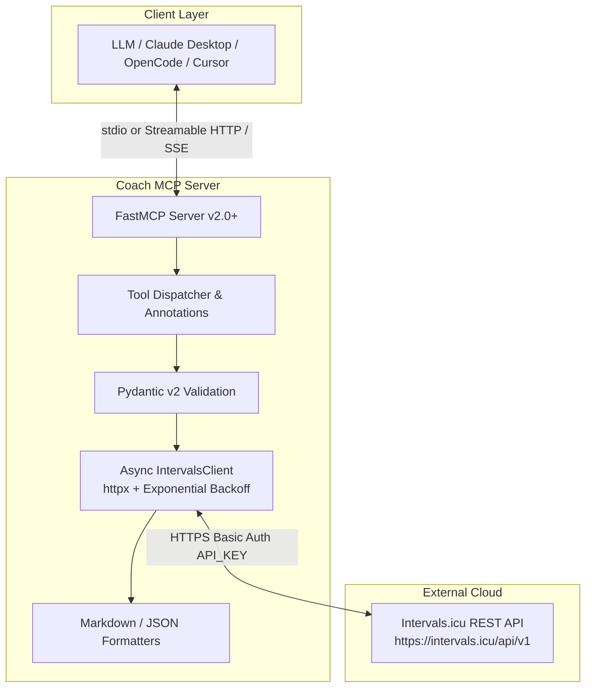
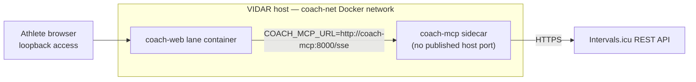

# Coach MCP Server — User Guide

> **Version**: 0.1.0  
> **Scope**: Setup, configure, deploy, and connect the Coach MCP Server to Intervals.icu and your favourite LLM client.  
> **Companion**: See [`README.md`](../README.md) for project overview, architecture diagram, and quick-start snippets.

---

## Table of Contents

1. [System Overview & Architecture](#1-system-overview--architecture)
2. [Prerequisites](#2-prerequisites)
3. [Configuration Reference](#3-configuration-reference)
4. [Deployment Methods](#4-deployment-methods)
5. [Client Integration Guides](#5-client-integration-guides)
6. [Complete Tool Catalog](#6-complete-tool-catalog)
7. [Intervals.icu Workout DSL Guide](#7-intervalsicu-workout-dsl-guide)
8. [Troubleshooting & Operational Best Practices](#8-troubleshooting--operational-best-practices)

---

## 1. System Overview & Architecture

**Coach MCP** is a production-grade [Model Context Protocol (MCP)](https://modelcontextprotocol.io) server written in Python 3.11+. It exposes 29 tools that let an LLM (Claude, OpenCode, Cursor, etc.) read and write endurance-sports data through the [Intervals.icu](https://intervals.icu) REST API.



### Key design points

- **MCP Python SDK v2.0+** — `MCPServer` with strongly-typed Pydantic inputs, `ToolAnnotations`, and lifespan-managed HTTP client.
- **Dual transport** — `stdio` for local desktop clients; `streamable_http` / `sse` for remote or containerised deployments.
- **Resilient HTTP client** — Exponential backoff with `Retry-After` honouring for HTTP 429 and 5xx errors.
- **Clean stdio channel** — All logs are written to `stderr`; `stdout` is reserved for JSON-RPC framing.
- **Non-root OCI container** — Runs as `coach:coach` (`UID:GID 10001:10001`).
- **Markdown or JSON output** — Every read tool supports `response_format: markdown | json`.

---

## 2. Prerequisites

### 2.1 Intervals.icu account

You need an active [Intervals.icu](https://intervals.icu) account with at least one athlete profile.

### 2.2 API key

1. Log in to Intervals.icu.
2. Go to **Settings** → **Developer Settings** (near the bottom).
3. Generate an **API key**.
4. Copy and store it securely — it is the password used for HTTP Basic Auth.

> **Security note**: Treat the API key like a password. Rotate it immediately if it is exposed.

### 2.3 Athlete ID resolution

| Value | Meaning |
| :--- | :--- |
| `0` | The athlete associated with the API key (yourself). |
| `iXXXXX` | A coached athlete (e.g., `i123456`). |
| Numeric ID | Direct Intervals.icu athlete identifier (e.g., `2049151`). |

Set `INTERVALS_ATHLETE_ID=0` for personal use. For coached athletes, use their Intervals.icu athlete ID.

### 2.4 Runtime requirements

- Python **3.11+** for local installation.
- Or [Docker](https://docs.docker.com/get-docker/) / [Docker Compose](https://docs.docker.com/compose/) for containerised deployment.

---

## 3. Configuration Reference

Coach MCP is configured entirely through environment variables. Create a `.env` file in the project root or export variables directly.

| Variable | Description | Default |
| :--- | :--- | :--- |
| `INTERVALS_API_KEY` | **Required.** Your Intervals.icu API key. | — |
| `INTERVALS_ATHLETE_ID` | Athlete ID (`0` for self, `iXXXXX` for coached athlete). | `0` |
| `INTERVALS_BASE_URL` | Intervals.icu API base URL. | `https://intervals.icu/api/v1` |
| `COACH_MCP_AUTH_TOKEN` | Bearer token protecting the MCP HTTP endpoint (streamable-http/SSE). | — |
| `MCP_TRANSPORT` | Transport mode: `stdio`, `streamable_http`, `streamable-http`, or `sse`. | `stdio` |
| `MCP_HOST` | Host to bind for HTTP / SSE transport. | `0.0.0.0` |
| `MCP_PORT` | Port to bind for HTTP / SSE transport. | `8000` |
| `HTTP_TIMEOUT_SECONDS` | HTTP request timeout in seconds. | `30.0` |
| `HTTP_MAX_RETRIES` | Maximum retry attempts on 429 / 5xx / network errors. | `3` |
| `CACHE_TTL_SECONDS` | Default TTL in seconds for semi-static cached responses. | `300` |
| `CACHE_TTL_VOLATILE_SECONDS` | TTL in seconds for volatile cached responses (activities, wellness, events, etc.). | `60` |

### Example `.env` file

```bash
# Intervals.icu API Configuration
INTERVALS_API_KEY=your_api_key_here
INTERVALS_ATHLETE_ID=0
INTERVALS_BASE_URL=https://intervals.icu/api/v1

# MCP Transport Configuration
MCP_TRANSPORT=stdio
MCP_HOST=0.0.0.0
MCP_PORT=8000

# HTTP Client Behaviour
HTTP_TIMEOUT_SECONDS=30.0
HTTP_MAX_RETRIES=3

# Caching
CACHE_TTL_SECONDS=300
CACHE_TTL_VOLATILE_SECONDS=60
```

### Notes

- `MCP_TRANSPORT` accepts both `streamable_http` (underscore) and `streamable-http` (hyphen) for convenience.
- For stdio clients (Claude Desktop, OpenCode), keep `MCP_TRANSPORT=stdio`.
- For the containerised HTTP/SSE path (coach-web sidecar, §4.2), set `MCP_TRANSPORT=sse`; `MCP_HOST`/`MCP_PORT` bind **inside** the Docker network only — the sidecar publishes no host ports.

### Docker secrets (`_FILE` pattern)

`INTERVALS_API_KEY` and `COACH_MCP_AUTH_TOKEN` can be read from Docker secret files instead of environment variables, so they no longer appear in `docker inspect` output or `/proc/<pid>/environ`:

- Set `INTERVALS_API_KEY_FILE` (or `COACH_MCP_AUTH_TOKEN_FILE`) to the path of a mounted secret file — Docker secrets mount at `/run/secrets/<name>` with mode `0400` — and the secret is read from that file at startup.
- **Precedence:** the `_FILE` variant is authoritative when set. Setting **both** the direct env var and its `_FILE` variant is ambiguous and fails fast at startup (silent precedence could mask a stale secret and surface only as confusing 401s downstream).
- **Fail-fast:** a missing, unreadable, or empty secret file aborts startup with a clear error naming the env var and file path. The file path may appear in logs; the secret content never does.
- `_FILE` variants are read from the process environment only (compose/Kubernetes `environment:`), not from the `.env` file.

Example Docker Compose integration (client-side compose lives in the `coach-web` repo):

```yaml
services:
  coach-mcp:
    secrets:
      - intervals_api_key
      - coach_mcp_auth_token
    environment:
      INTERVALS_API_KEY_FILE: /run/secrets/intervals_api_key
      COACH_MCP_AUTH_TOKEN_FILE: /run/secrets/coach_mcp_auth_token

secrets:
  intervals_api_key:
    file: ./secrets/intervals_api_key.txt
  coach_mcp_auth_token:
    file: ./secrets/coach_mcp_auth_token.txt
```

---

## 4. Deployment Methods

Coach MCP ships as OCI images to the [GitHub Container Registry](https://github.com/fpittelo/coach/pkgs/container/coach). Per [ADR 0001](adr/0001-local-docker-only-deployment-on-vidar.md), the only ratified deployment is **local-Docker-only on VIDAR**: the server runs as a sidecar container beside [coach-web](https://github.com/fpittelo/coach-web) on an internal Docker network, with no published host ports. Cloud or remote hosting is explicitly out of scope.

Two ways to run the server:

- **Local development (stdio)** — for working on the server itself; this is how the desktop clients in §5 connect.
- **Production on VIDAR (sidecar)** — the coach-web lane topology consumes the published GHCR images. This repository publishes images only and keeps no compose stacks of its own.

### 4.1 Local development (stdio)

#### Using `uv` (recommended)

```bash
# Clone the repository
git clone https://github.com/fpittelo/coach.git
cd coach

# Create virtual environment and install
uv venv --python 3.11
source .venv/bin/activate
uv pip install -e ".[dev]"

# Run the server (stdio)
INTERVALS_API_KEY="your_api_key" INTERVALS_ATHLETE_ID="0" coach-mcp
```

#### Using `pip`

```bash
python -m venv .venv
source .venv/bin/activate
pip install -e ".[dev]"

# Run via installed CLI
coach-mcp

# Or run the module directly
python -m coach_mcp.server
```

#### Ad-hoc container run (optional)

```bash
docker build -t coach-mcp .
docker run -i --rm \
  -e INTERVALS_API_KEY="your_api_key" \
  -e INTERVALS_ATHLETE_ID="0" \
  coach-mcp
```

#### Verify the installation

```bash
# Run linting
ruff check .

# Run tests
pytest -v --cov=src/coach_mcp tests/
```

### 4.2 Production topology on VIDAR (sidecar, no host ports)

Production deployment is owned by the **coach-web lane topology** (see [ADR 0001](adr/0001-local-docker-only-deployment-on-vidar.md)). Each coach-web lane — `dev`, `qa`, `prod` — runs `coach-mcp` as a sidecar container alongside the lane's `coach-web` container:



How it works:

- **One host, loopback only.** Everything runs on VIDAR, the single personal host. The athlete reaches the stack through coach-web; nothing needs to be reachable from the internet.
- **Internal Docker network.** The lane's containers share the `coach-net` Docker network. coach-web connects to the MCP endpoint at `COACH_MCP_URL=http://coach-mcp:8000/sse` (SSE transport).
- **No published host ports.** `coach-mcp` listens on port 8000 *inside* the Docker network only — there is no `-p` / `ports:` mapping, so the MCP endpoint is unreachable from the host or the LAN. (Bearer auth via `COACH_MCP_AUTH_TOKEN` stays in place as defense-in-depth; see §3 for how the token is supplied.)
- **Per-lane image tags.** The lanes pull `ghcr.io/fpittelo/coach:dev`, `:qa` and `:prod` respectively — see §4.3 for the full tag contract.
- **Secrets.** `INTERVALS_API_KEY` and `COACH_MCP_AUTH_TOKEN` are injected as Docker secrets using the `_FILE` pattern — setup is covered in §3 (Docker secrets).
- **Container hardening.** The lane compose runs the sidecar with `read_only: true`, `cap_drop: ALL` and `no-new-privileges:true`, as the non-root user `coach:coach` (`UID:GID 10001:10001`) baked into the image. Do not override the user to root.

> **Note**: This repository intentionally ships no `compose.yaml` of its own — standalone compose stacks were superseded by ADR 0001. To run or restart the production stack, use the coach-web lane scripts.

### 4.3 Updating production with a pinned digest

Images are published to GHCR by the `deploy.yaml` workflow with this tag contract:

| Trigger | GHCR tags |
| :--- | :--- |
| Push to `dev` | `:dev`, `:<commit-sha>` |
| Merge to `qa` | `:qa`, `:<commit-sha>` |
| Merge to `main` | `:prod`, `:latest`, `:<commit-sha>` |
| Push a `v*` release tag | `v*`, `:prod`, `:latest`, `:<commit-sha>` |

`:prod` and `:latest` are **mutable**: they are pointers that move to whichever image the most recent release built. A **digest** (`@sha256:…`) is **immutable**: it always resolves to the exact image it was recorded for and can never be re-pointed.

For production, pin the digest so the running image can never change underneath you:

```yaml
# coach-web prod lane (compose.prod.yml)
services:
  coach-mcp:
    image: ghcr.io/fpittelo/coach@sha256:0123abcdef…
```

#### Manual update procedure

1. **Look up the digest** of the release you want — inspect the `:prod` tag, or read it off the GHCR package page:

   ```bash
   docker buildx imagetools inspect ghcr.io/fpittelo/coach:prod
   # → Digest: sha256:0123abcdef…
   ```

2. **Pull the pinned digest** (never the mutable tag):

   ```bash
   docker pull ghcr.io/fpittelo/coach@sha256:0123abcdef…
   ```

3. **Verify** that the local image carries exactly that digest:

   ```bash
   docker images --digests ghcr.io/fpittelo/coach
   ```

4. **Restart** the prod lane: point the coach-web prod lane compose at the new digest and restart the lane (coach-web's lane scripts gate the restart on container healthchecks).

Because a digest is immutable, the prod lane keeps running exactly this image until you deliberately pin a new one — `:prod` and `:latest` moving on the registry never affects a pinned deployment.

> **Supply-chain note**: Digest pinning is the image-level equivalent of the locked-dependency hygiene adopted for the Python supply chain (#105): what you verified is what you run.

If the GHCR package is private, log in first with a token carrying the `read:packages` scope:

```bash
echo $GITHUB_TOKEN | docker login ghcr.io -u <username> --password-stdin
```

For public packages, no authentication is required to pull.

---

## 5. Client Integration Guides

### 5.1 Claude Desktop

Edit your `claude_desktop_config.json`:

- **macOS**: `~/Library/Application Support/Claude/claude_desktop_config.json`
- **Windows**: `%APPDATA%\Claude\claude_desktop_config.json`

#### Local Python stdio

```json
{
  "mcpServers": {
    "coach": {
      "command": "coach-mcp",
      "env": {
        "INTERVALS_API_KEY": "your_api_key_here",
        "INTERVALS_ATHLETE_ID": "0",
        "MCP_TRANSPORT": "stdio"
      }
    }
  }
}
```

#### Docker stdio

```json
{
  "mcpServers": {
    "coach": {
      "command": "docker",
      "args": [
        "run",
        "-i",
        "--rm",
        "-e", "INTERVALS_API_KEY=your_api_key_here",
        "-e", "INTERVALS_ATHLETE_ID=0",
        "-e", "MCP_TRANSPORT=stdio",
        "ghcr.io/fpittelo/coach:v0.6.2"
      ]
    }
  }
}
```

Pin a released `v*` tag as shown — never the mutable `:latest` (see §4.3 for digest pinning).

Restart Claude Desktop after editing. The Coach tools appear under the hammer 🔨 menu.

### 5.2 OpenCode

Add the server to your `opencode.json` (typically in `~/.config/opencode/opencode.json` or project root):

```json
{
  "mcpServers": {
    "coach": {
      "command": "coach-mcp",
      "args": [],
      "env": {
        "INTERVALS_API_KEY": "your_api_key_here",
        "INTERVALS_ATHLETE_ID": "0",
        "MCP_TRANSPORT": "stdio"
      },
      "description": "Intervals.icu endurance coaching data and workout planning"
    }
  }
}
```

For Docker stdio, replace `command`/`args` with the Docker invocation shown in the Claude Desktop section.

### 5.3 Cursor / Cline / Windsurf / Generic MCP clients

Most generic MCP clients accept the same `command` + `env` stdio configuration as Claude Desktop.

#### stdio configuration template

```json
{
  "mcpServers": {
    "coach": {
      "command": "coach-mcp",
      "env": {
        "INTERVALS_API_KEY": "your_api_key_here",
        "INTERVALS_ATHLETE_ID": "0",
        "MCP_TRANSPORT": "stdio"
      }
    }
  }
}
```

#### HTTP / SSE configuration template

Coach MCP also speaks MCP over SSE and streamable HTTP. In the ratified deployment topology (§4.2, [ADR 0001](adr/0001-local-docker-only-deployment-on-vidar.md)) that endpoint is consumed **inside the Docker network** by coach-web (`COACH_MCP_URL=http://coach-mcp:8000/sse`). The sidecar publishes no host ports, so the endpoint is deliberately not reachable from `localhost`, the LAN, or the internet.

Desktop and generic MCP clients should therefore use the **stdio** configuration above; there is no ratified direct-HTTP client path from outside the Docker network.

> **Note**: Not all clients support streamable HTTP or SSE. Claude Desktop currently uses stdio only. Cursor, Cline, and Windsurf support varies by version; consult their MCP documentation.

---

## 6. Complete Tool Catalog

Coach exposes **29 tools** grouped into eight categories. All read tools support `response_format: markdown | json`.

> **Two naming generations.** The 23 older tools carry the `intervals_*` prefix — coach-web consumes them in production, so renaming them would be a breaking change and the names stay. The 6 newer tools carry the `icu_*` prefix, the going-forward naming convention (ratified in #90); future tools will use it.

### 6.1 Athlete Profiling

| Tool | Description | Sample Input | Sample Output |
| :--- | :--- | :--- | :--- |
| `intervals_get_athlete_profile` | Athlete name, weight, resting HR, max HR, location. | `{"athlete_id": "0", "response_format": "markdown"}` | Markdown profile summary or raw JSON. |
| `intervals_get_sport_settings` | FTP, LTHR, max HR, power zones, HR zones per sport. | `{"athlete_id": "0", "response_format": "markdown"}` | Sport settings table with zones. |

### 6.2 Activities

| Tool | Description | Sample Input | Sample Output |
| :--- | :--- | :--- | :--- |
| `intervals_list_activities` | List workouts in a date range with duration, distance, power, HR, TSS. | `{"oldest": "2026-08-01", "newest": "2026-08-22", "limit": 50}` | Markdown table of activities. |
| `intervals_get_activity` | Detailed metrics: NP, IF, TSS, training effects, RPE, feel. | `{"activity_id": "i12345678"}` | Detailed activity report. |
| `intervals_get_activity_streams` | Second-by-second sensor streams (watts, HR, cadence, altitude, etc.). | `{"activity_id": "i12345678", "types": ["watts", "heartrate"]}` | Stream metadata + first data points. |
| `intervals_get_activity_intervals` | Detected work/recovery intervals with power, HR, cadence. | `{"activity_id": "i12345678"}` | JSON array of intervals. |
| `intervals_create_activity` | Manually record a completed workout. | `{"name": "Morning Ride", "type": "Ride", "start_date_local": "2026-08-22T07:00:00", "moving_time_seconds": 3600}` | Success message with created activity ID. |
| `intervals_update_activity` | Update title, feel, RPE, training load, notes. | `{"activity_id": "i12345678", "feel": 2, "perceived_exertion": 7.5}` | Success confirmation. |
| `intervals_delete_activity` | Permanently delete an activity. ⚠️ Destructive. | `{"activity_id": "i12345678"}` | Success confirmation. |

### 6.3 Wellness / Recovery

| Tool | Description | Sample Input | Sample Output |
| :--- | :--- | :--- | :--- |
| `intervals_get_wellness` | Daily resting HR, HRV, sleep, readiness, fatigue, soreness. | `{"oldest": "2026-08-01", "newest": "2026-08-22"}` | Wellness table. |
| `intervals_record_wellness` | Record or update daily wellness metrics. | `{"date": "2026-08-22", "restingHR": 48, "readiness": 85.5}` | Success confirmation. |
| `intervals_record_wellness_bulk` | Record or update wellness for multiple days in one call. | `{"records": [{"date": "2026-08-22", "restingHR": 48}, {"date": "2026-08-23", "readiness": 85.5}]}` | Success confirmation. |
| `intervals_get_readiness_dashboard` | Composite daily readiness dashboard synthesized from wellness and sport settings. | `{"athlete_id": "0", "days": 7, "response_format": "markdown"}` | Readiness dashboard table. |

### 6.4 Fitness / Banister model

| Tool | Description | Sample Input | Sample Output |
| :--- | :--- | :--- | :--- |
| `intervals_get_fitness_summary` | CTL (Fitness), ATL (Fatigue), TSB (Form) summary and trend. | `{"oldest": "2026-08-01", "newest": "2026-08-22"}` | Fitness status + 7-day trend table. |

### 6.5 Calendar Events

| Tool | Description | Sample Input | Sample Output |
| :--- | :--- | :--- | :--- |
| `intervals_list_events` | Scheduled workouts, notes, race targets in a date range. | `{"oldest": "2026-08-01", "newest": "2026-08-22", "category": "WORKOUT"}` | Events table. |
| `intervals_get_event` | Full event details including structured workout DSL. | `{"event_id": "evt_12345"}` | Event header + DSL block. |
| `intervals_create_event` | Schedule a new workout or calendar event. | `{"start_date_local": "2026-08-23T08:00:00", "name": "VO2max 4x4", "type": "Ride", "category": "WORKOUT", "workout_doc": "Warmup\n- 10m 50-65% 90rpm\n\nMain Set\n4x\n- 4m 115% 100rpm\n- 3m 50% 85rpm\n\nCooldown\n- 10m 50% 85rpm"}` | Success with event ID. |
| `intervals_update_event` | Update date, title, description, or DSL steps. | `{"event_id": "evt_12345", "name": "Updated Workout"}` | Success confirmation. |
| `intervals_delete_event` | Delete a scheduled event. ⚠️ Destructive. | `{"event_id": "evt_12345"}` | Success confirmation. |

### 6.6 Workout Library

| Tool | Description | Sample Input | Sample Output |
| :--- | :--- | :--- | :--- |
| `intervals_list_folders` | Custom folders organising workout templates. | `{}` | Folder list with item counts. |
| `intervals_list_workouts` | Reusable workout templates, optionally filtered by folder. | `{"folder_id": "folder_abc123"}` | Workout template list. |

### 6.7 Power Analytics

| Tool | Description | Sample Input | Sample Output |
| :--- | :--- | :--- | :--- |
| `intervals_get_power_curve` | Mean-maximal power (MMP) curve for the athlete or a specific activity. | `{"athlete_id": "0", "sport_type": "Ride", "response_format": "markdown"}` | Markdown MMP curve table. |
| `intervals_get_power_model` | Critical power (CP), anaerobic work capacity (W′) and Pmax model. | `{"athlete_id": "0", "sport_type": "Ride", "response_format": "markdown"}` | CP / W′ / Pmax model summary. |

### 6.8 Intervals.icu Bounded Tools (`icu_*`)

The `icu_*` tools are the going-forward generation (epic #82): every read is bounded to a 90-day window and whitelist-projected, and every write passes a confirmation gate.

| Tool | Description | Sample Input | Sample Output |
| :--- | :--- | :--- | :--- |
| `icu_get_wellness` | Daily wellness records over a bounded 90-day window, whitelist-projected (sleep, HRV, soreness, fatigue, stress, readiness, CTL/ATL/TSB). | `{"oldest": "2026-08-01", "newest": "2026-08-22"}` | Whitelisted wellness table. |
| `icu_add_session_comment` | Post a coach debrief comment on a completed activity (write-gated: `confirmed=true` required). | `{"activity_id": "i12345678", "comment": "Solid threshold session, fueling on target.", "confirmed": true}` | Success confirmation. |
| `icu_batch_create_events` | Place a weekly batch of planned workouts on the calendar (two-phase gate: dry-run preview returns a `confirm_token`, re-invoke with it to execute). | `{"events": [{"external_id": "wk37-tue", "date": "2026-08-25", "name": "VO2max 4x4", "type": "Ride"}]}` | Per-item created/updated/failed report. |
| `icu_get_workout_compliance` | Planned-vs-executed adherence over a bounded 90-day range, joined by Intervals.icu's native `paired_event_id`. | `{"oldest": "2026-08-18", "newest": "2026-08-25"}` | Compliance report with adherence rate. |
| `icu_get_completed_sessions` | Completed sessions over a bounded 90-day range — id, date, type, title, duration and load only. | `{"oldest": "2026-08-18", "newest": "2026-08-25", "limit": 50}` | Session summary table. |
| `icu_get_trends` | CTL/ATL/TSB trend aggregates over a bounded 90-day range, downsampled to weekly or daily granularity. | `{"oldest": "2026-08-01", "newest": "2026-08-22", "granularity": "weekly"}` | Trend series table. |

---

## 7. Intervals.icu Workout DSL Guide

Planned workouts are created with the `intervals_create_event` tool using the `workout_doc` field. The `workout_doc` is plain text written in the Intervals.icu native workout description language.

The MCP tool delivers this DSL text via the calendar `description` field of the Intervals.icu API: the server parses the DSL from `description` and compiles the structured workout on its side. The API `workout_doc` field itself expects a structured JSON object on write, so the tool never sends a raw DSL string there. When both `description` (human text) and `workout_doc` (DSL) are provided, the tool combines them as `"{description}\n\n{workout_doc}"` — human text, a blank line, then the DSL steps. When reading events back, the API may return `workout_doc` as structured JSON (the compiled workout document).

### 7.1 Syntax rules

| Rule | Format | Example |
| :--- | :--- | :--- |
| **H** — Header / section name | Plain text line | `Warmup` |
| **O** — One step per line | Each step starts with `-` | `- 10m 50%` |
| **M** — Multiplier / repeat block | `Nx` followed by indented steps | `3x` then `- 2m 105%` |
| **E** — End with cooldown | Final section is recovery | `Cooldown` |
| Duration | `h`, `m`, `s` | `5m`, `30s`, `1h` |
| Power target | `%ftp` or absolute `W` | `85%`, `200W` |
| Power range | Use a hyphen | `50-65%`, `200-250W` |
| Cadence | Append `rpm` | `90rpm` |
| Ramp | Use the `ramp` keyword | `10m ramp 60%-90%` |
| Zone | Use `Z1`–`Z7` | `5m Z2` |

### 7.2 HOME Rule #6 — Explicit wattage targets

When you know the athlete's FTP, prefer explicit wattage values over percentages for precision. Rule #6 states:

> **Use absolute watts (`W`) for fixed targets when the exact load must be preserved regardless of FTP changes.**

This is especially useful for:

- Indoor trainer workouts where the trainer receives absolute targets.
- Prescribing workouts for athletes whose FTP is updated frequently.
- Sharing workouts between athletes with different FTPs while keeping the same absolute stimulus.

#### Example: 4-phase workout with explicit wattage

```text
Warm-up
- 10m 150W 90rpm

Work Intervals
5x
- 3m 250W 100rpm
- 2m 150W 85rpm

Rest
- 5m 120W 80rpm

Wind-down
- 10m ramp 150W-100W 85rpm
```

#### JSON payload for `intervals_create_event`

The example below is the MCP tool input. The tool maps it to the outgoing API payload by merging the DSL into the calendar `description` field (`"{description}\n\n{workout_doc}"`); the API `workout_doc` key is never sent.

```json
{
  "start_date_local": "2026-08-23T08:00:00",
  "name": "Threshold 5x3min (Explicit Watts)",
  "type": "Ride",
  "category": "WORKOUT",
  "description": "5 x 3 min threshold intervals with explicit wattage targets.",
  "workout_doc": "Warm-up\n- 10m 150W 90rpm\n\nWork Intervals\n5x\n- 3m 250W 100rpm\n- 2m 150W 85rpm\n\nRest\n- 5m 120W 80rpm\n\nWind-down\n- 10m ramp 150W-100W 85rpm",
  "moving_time_seconds": 3000,
  "icu_training_load": 75
}
```

### 7.3 Additional examples

#### Percentage-based VO2max intervals

```text
Warmup
- 10m 50-65% 90rpm

Main Set
4x
- 4m 115% 100rpm
- 3m 50% 85rpm

Cooldown
- 10m 50-40% 80rpm
```

#### Sweet-spot with cadence variations

```text
Warmup
- 12m ramp 50%-75% 85rpm

Main Set
- 10m 88% 85rpm
- 5m 88% 70rpm
- 10m 88% 90rpm
- 5m Z1 85rpm

Cooldown
- 8m 50%-40% 80rpm
```

---

## 8. Troubleshooting & Operational Best Practices

### 8.1 Authentication errors (401 / 403)

**Symptom**: `Authentication failed (401). Check INTERVALS_API_KEY.`

**Resolution**:

1. Verify `INTERVALS_API_KEY` is set and matches the key in **Settings → Developer Settings**.
2. Ensure there are no trailing spaces or newline characters.
3. Regenerate the key if it was revoked or exposed.
4. Confirm the athlete ID is valid and accessible with the API key.

### 8.2 Rate limiting (429)

**Symptom**: `Intervals.icu rate limit exceeded. Please wait before retrying.`

**Resolution**:

- Coach MCP automatically retries on HTTP 429 using the `Retry-After` header with exponential backoff.
- If retries are exhausted, wait and retry the request later.
- Reduce request frequency; Intervals.icu limits API-key callers to **5000 requests/day** and **2500 requests per 15-minute window**.
- Avoid polling in tight loops; cache results where possible.

### 8.3 stdio logging clean framing

**Symptom**: MCP client reports malformed JSON-RPC messages.

**Resolution**:

- Coach MCP logs exclusively to `stderr`; `stdout` is reserved for JSON-RPC.
- Do not run the server with `PYTHONUNBUFFERED=0` in a way that redirects `stderr` to `stdout`.
- When debugging, capture `stderr` separately:

```bash
coach-mcp 2> coach-mcp.log
```

### 8.4 Docker networking

**Symptom**: HTTP/SSE client cannot reach the container.

**Resolution**:

- Confirm the client and `coach-mcp` share the same Docker network (`coach-net` in the lane topology): the MCP endpoint is reachable only inside the network, and the sidecar publishes no host ports (§4.2) — host-port or `localhost` paths cannot work by design.
- Verify the client's `COACH_MCP_URL` points at the service name (`http://coach-mcp:8000/sse`), not `localhost`.
- For Docker Compose, confirm the service is healthy: `docker compose ps`.

### 8.5 Timeouts on large requests

**Symptom**: `Connection timeout or network failure`.

**Resolution**:

- Increase `HTTP_TIMEOUT_SECONDS` for large activity stream requests.
- Reduce the date range or activity limit to keep responses smaller.
- Check network connectivity to `https://intervals.icu`.

### 8.6 General best practices

- **Use `.env` files** for local development, but never commit secrets.
- **Pin image tags** in production (`ghcr.io/fpittelo/coach:prod` or a SHA) instead of `latest`.
- **Run as non-root** in containers; the image already uses `UID 10001`.
- **Keep dependencies updated** by rebuilding the image after `pyproject.toml` changes.
- **Monitor rate-limit headers** returned by Intervals.icu (`X-RateLimit-Remaining`) if building automation.

---

## Quick reference card

```bash
# Local stdio
coach-mcp

# Local HTTP
coach-mcp   # with MCP_TRANSPORT=streamable_http

# Docker stdio (dev-lane tag)
docker run -i --rm -e INTERVALS_API_KEY=... ghcr.io/fpittelo/coach:dev

# Production sidecar: digest-pinned image, no published host ports (see §4.3)
# ghcr.io/fpittelo/coach@sha256:… — consumed via the coach-web lane compose

# Lint & test
ruff check .
pytest -v --cov=src/coach_mcp tests/
```

---

*For development details, architecture, and contribution guidelines, see [`README.md`](../README.md).*
